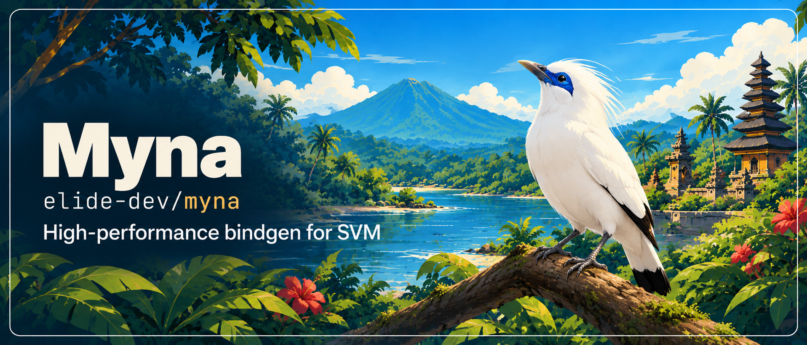
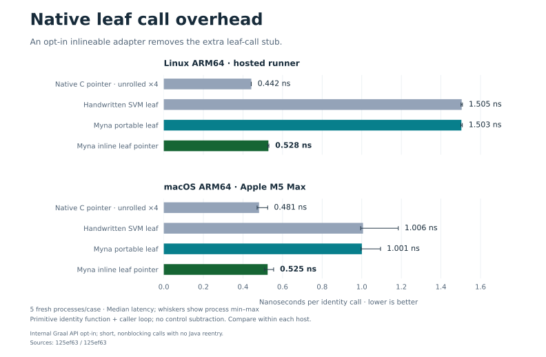
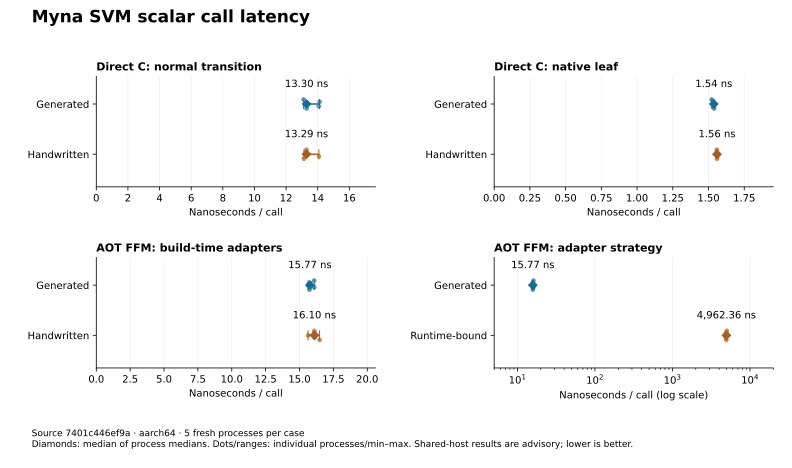

[](https://github.com/elide-dev/myna/actions/workflows/on.push.yml)
[](https://app.codspeed.io/elide-dev/myna?utm_source=badge)
[](https://codecov.io/gh/elide-dev/myna)
[](https://scorecard.dev/viewer/?uri=github.com/elide-dev/myna)
[](LICENSE)
[](https://elide.dev/discord)


# Myna

A Native Image command-line generator for Rust / Substrate VM seams. One typed Seam IR produces C headers, Rust raw FFI, Java FFM, `@CFunction` imports, `@CEntryPoint` exports, JSON descriptors, and LLVM 23 contracts.

**`myna apply` attaches those contracts to the actual LLVM objects and Rust archive members that participate in ThinLTO.** It updates matching functions and direct calls, verifies ABI signatures, and rebuilds summaries and module hashes before linkage. See [the integration design](docs/thinlto.md).

**Substrate VM is the primary runtime.** Fixed symbols use direct generated C API bindings; explicitly contracted native leaf calls can elide VM transitions. Build-time FFM registration is an optional adapter. See [the performance design](docs/performance.md).

See [releases](https://github.com/elide-dev/myna/releases) for published SDKs and checksums, and [the migration guide](docs/rename.md) for the earlier project rename. Myna is dual-licensed under **Apache-2.0 OR MIT**, at your option; see [licensing](LICENSE), [contribution guidance](CONTRIBUTING.md), and the [security policy](SECURITY.md).

## Call overhead

**Short native leaves can get close to the native-call floor.** On the pinned Linux ARM64 run, the opt-in inlineable leaf pointer takes **0.53 ns per identity call**, versus **1.50 ns** for ordinary generated or handwritten SVM leaves and **0.44 ns** for an unrolled native function-pointer caller.



The [typed leaf-pointer example](examples/leaf-pointer/README.md) uses Myna's existing signature mapping and resolves the address once at runtime. It removes the extra leaf adapter stub, uses **internal Graal API**, and requires short, bounded, nonblocking, primitive-only calls with **no Java reentry**. Ordinary generated bindings retain the portable Native Image API. Both paths are exercised with the pinned compiler; the opt-in path also passes concurrent allocation/GC stress.

The chart measures an identity function plus its caller loop, with no control subtraction. Five fresh processes expose process variation. Compare within each host. In the Linux arithmetic workload, the inlineable pointer measures **0.76 ns/op**; a bounded 16-call Java batch reaches **0.59 ns/op**, close to the native arithmetic baseline. Explicit loop unrolling is measured separately: it helps the identity workload on the Mac but is not a universal improvement.

[Linux raw measurements](benchmarks/comparison/baselines/leaf-floor-linux-arm64.json) · [Linux results](benchmarks/comparison/baselines/leaf-floor-linux-arm64.md) · [Mac results](benchmarks/comparison/baselines/leaf-floor-macos-arm64.md) · [Rerun the floor experiment](benchmarks/floor/README.md) · [Machine-code evidence](benchmarks/comparison/evidence/README.md)

<details>
<summary>Portable normal-transition, native-leaf, and AOT FFM baseline</summary>

Direct generated SVM bindings perform on par with handwritten Native Image C calls in the retained v0.7.2 scalar benchmark. Normal transitions take about **13.3 ns/call**; native leaves take about **1.5 ns/call**. The inspected generated and handwritten direct-call paths produce matching instruction sequences.



These latencies include the scalar callee and loop; the roughly 0.59 ns control is not subtracted. Transition contracts differ across pairs. These are shared-host measurements, not universal latency guarantees.

[Raw measurements](benchmarks/comparison/baselines/hosted-arm64-0.7.2.json) · [Process statistics and interop comparisons](benchmarks/comparison/baselines/hosted-arm64-0.7.2.md) · [Rerun commands](docs/benchmarking.md) · [Regenerate charts](docs/benchmarking.md#performance-charts)

</details>

## Build and use

Requirements: mise 2026.10.25+ and the platform SDK. mise installs pinned Elide 1.6.2, elide-dev/toolchain 2026.11.1 (including LLVM/LLD), Rust, CMake, and workflow linters. Setup installs the checksum-pinned elide-dev/graal 25.5.5-elide.24 distribution. Elide supplies Java compilation and Python; native builds use the pinned external GraalVM driver.

```sh
mise trust
mise install --locked
mise run setup                      # Elide Python component and dependencies
mise run build                      # native executable, generator JAR, Feature JAR
mise run build:llvm

build/dist/myna generate examples/buffer.seam --out build/seam
build/dist/myna validate examples/buffer.seam
build/dist/myna generate examples/buffer.seam --out build/seam --check
```

Outputs live in `build/dist/`. `elide.pkl` is the primary application build. `pom.xml` remains an optional Maven compatibility build. The Java generator has no runtime dependencies. Native compilation uses the pinned external elide-dev/graal Native Image driver.

The descriptor target is explicit. Use `--target x86_64-unknown-linux-gnu` to override the example's macOS ARM64 target. The CLI never guesses an ABI from its own host.

```sh
# Compile Rust for linker-driven ThinLTO, then annotate its real archive.
rustc --crate-type=rlib -Clinker-plugin-lto src/lib.rs -o build/libapp.rlib
build/dist/myna apply \
  --contracts build/seam/seam.ll \
  --input build/libapp.rlib --output build/libapp.seam.rlib \
  --llvm-tool build/dist/myna-llvm
```

Use the rewritten archive/object in the final LLVM 23 / LLD link. A contract-only `.ll` file is an interchange artifact; simply adding it to a link is insufficient. Keep the original object: changed contracts must be applied to fresh compiler output.

## Binding descriptions

The initial frontend is a strict, line-oriented text DSL with `#` comments. See [the DSL reference](docs/dsl.md), [the owned end-to-end fixture](examples/buffer.seam), and [the inventoried Elide LZMA ABI](examples/elide_lzma.seam).

```text
module example abi=1 target=x86_64-unknown-linux-gnu
import readCount symbol=example_read_count return=i64 error=no_failure
  param value type=ptr<i64> nullable=false ownership=borrowed access=read nonnull=true@explicit_contract readonly=true@explicit_contract
end
```

Every generation produces:

- `seam.h`, `seam.rs`, `MynaFFM.java`, `MynaNative.java`, `MynaForeignFeature.java`
- `seam.json` with optimizer-fact provenance, `seam.abi` with a SHA-256 fingerprint
- `seam.ll`, consumed by `myna apply` or assembled by LLVM 23's `llvm-as`

Strict mode rejects unapproved facts. `--relaxed` preserves them in JSON and omits them from LLVM. Unsupported shapes and contradictory contracts always fail. Explicit contracts are obligations of the implementation; validation cannot prove an arbitrary native implementation obeys them.

Native Image import classes can opt into `c_context`, `c_library`, and `c_library_static`. Callback signatures can reference consumer-maintained function-pointer interfaces with `java_type`. See [the DSL integration options](docs/dsl.md#native-image-c-context-library-linkage-and-handwritten-callbacks).

## Ownership and off-heap buffers

Explicit `resource` and `borrow` declarations generate Rust owners/lifetimes and an optional Native Image ownership API. Native Image consumers implement their own lifecycle and GC integration; the generator supplies reusable destructor callbacks. Off-heap buffers expose consumer-controlled acquire/release hooks around zero-copy direct calls. See [ownership contracts and adoption](docs/ownership.md) and [the executable example](examples/ownership.seam).

## Rust Serde and JSON-shaped values

The `myna-values` Rust crate maps `Serialize` structs and dynamic values directly into a native value tape for SVM consumption. It supports nested JSON types without JSON text or an intermediate object tree. `bumpalo` is the default arena; caller-supplied `allocator-api2` allocators control both backing buffers. Documents reuse capacity; strings up to 16 UTF-8 bytes stay inline. SVM traverses nodes directly with prepared field keys and lazy string materialization. Byte-sourced UTF-8 validation and optional bulk SVM transcoding use `simdutf`. ABI v3 adds direct Rust/C++ builders, borrowed text regions, and exact JSON-number tokens. The C++ builder accepts PMR allocators and is tested with C++ simdjson; SVM readers ship in a separate `myna-values.jar`.

See [the API, ABI, allocator contracts, and performance notes](docs/values.md), [the seam example](examples/values.seam), and [the Rust/SVM integration fixture](tests/values). Run `mise run test:rust` and `mise run bench:values` for the crate's checks and benchmarks. This is the generic Rust → SVM path; schema-derived typed mapping and reverse deserialization remain future work.

## Tests and reports

```sh
mise run test:jvm              # Elide JVM tests, coverage reports, and thresholds
mise run test                  # also builds and tests native CLI, LLVM, and Native Image ABI
```

The full suite uses Elide's Python component, Rust 1.99.1 (pinned in `mise.toml`, using LLVM 23), and LLD 23. Set `LLVM_BIN` to that toolchain's `bin` directory and `LLVM_CONFIG` to its `llvm-config`. The LLVM helper must be built against the same LLVM toolchain used for linking; generic system LLVM is not a hermetic substitute for Elide's toolchain in production.

Individual integration tests can run against existing builds:

```sh
MYNA_BIN=build/dist/myna mise run test:e2e
mise run test:llvm
mise run test:native-image
```

| Report | Location |
| --- | --- |
| JVM test XML | `.dev/reports/tests/jvm/**/*.xml` |
| Production JVM coverage XML | `build/reports/jvm-production.xml` |
| JaCoCo coverage XML | `.dev/reports/coverage/jvm/jvm-test/jvm-test.xml` |
| JaCoCo HTML | `.dev/reports/coverage/jvm/jvm-test/html/index.html` |
| Native CLI / LLVM / Native Image test XML | `build/reports/*.xml` |

Production JVM coverage gates are 99% lines and 93% branches. Rust integration coverage requires 97.5% lines; native C/C++ and LLVM coverage require 98% lines. Native-only Java readers are exercised in SVM integration tests. Golden outputs are checked in under `tests/golden/`. The LLVM suite proves load elimination in both C and Rust, checks attributes in LLD's saved ThinLTO output, preserves archive metadata/native members, and rejects stale contracts and incompatible ABIs. The Native Image suite runs Rust → Native Image → Rust and tests exception translation and a leaf call with no VM transition. It also builds and runs the generated FFM bindings as a Native Image executable.

CI runs JVM tests and native integration on Linux and macOS, retaining the XML reports and built artifacts. Codecov receives JaCoCo coverage plus JVM and native JUnit test results, authenticated with GitHub OIDC. Upload errors fail CI. It uses the same mise tasks and lockfile as local development and requires LLVM major 23; update Rust and LLVM together. See [CI maintenance and Elide compatibility notes](docs/ci.md).

## Benchmarks

JMH benchmarks in `benchmarks/` cover the generator pipeline (DSL parsing, validation, JSON canonicalization and fingerprinting, every backend, and end-to-end generation) on the repository's example seams plus a synthetic large module. They use the [CodSpeed](https://codspeed.io) JMH fork, vendored as the `third-party/codspeed-jvm` submodule, and run in CI on compatible hosted ARM runners in walltime mode. Configure `MYNA_ARM_BENCH_RUNNER` for controlled compatible hardware; shared-host timings remain advisory.

```sh
git submodule update --init --recursive third-party/codspeed-jvm
# The CI ARM build uses benchmarks/codspeed.init.gradle to select the JNI target.
mise run bench:comparison-build
mise run bench:comparison
```

## Downstream distribution

Two Docker targets are provided:

```sh
docker build --target generator -t myna:local .
docker build --target llvm23 -t myna:local-llvm23 .
docker run --rm --user "$(id -u):$(id -g)" -v "$PWD:/work" myna:local \
  generate bindings.seam --out generated --target x86_64-unknown-linux-gnu
```

The `llvm23` variant also supports `apply` and includes the LLVM tools. The default image contains the native generator and its JAR. The Feature JAR is available from `build/dist/` and CI build artifacts. Both container builds use the checksum-pinned `elide-dev/toolchain` bundle, including its LLVM libraries and compiler runtime.

The container workflow builds and smoke-tests both variants on pull requests. Pushing a `v*` tag builds, tests, and publishes `ghcr.io/<owner>/<repo>:<tag>` and `<tag>-llvm23` using the repository's `GITHUB_TOKEN`. Images are Linux amd64 initially. Publication status is visible in the release workflow. Downstream builds should pin an image digest. See [release verification](docs/releases.md) for SBOM scope, provenance checks, symbols, and the draft-release process.

## Native Image Feature

Pre-generate and compile the Java glue before building the image. Add `myna-feature.jar` to the image builder's classpath and pass:

```text
--features=dev.elide.myna.nativeimage.MynaFeature
-Dmyna.input=/absolute/path/bindings.seam
-Dmyna.output=/absolute/path/build/seam
```

The Feature exports the validated descriptors during `beforeAnalysis`; it does not compile newly emitted Java during image analysis. It currently consumes explicit DSL facts. Annotation scanning and Graal-proven enrichment are future frontend work.

## Optional FFM and JNI adapters

Typed FFM calls and Native Image downcall-stub registration are implemented. Fuller FFM and Static JNI adapters are future compatibility work, subordinate to the direct Substrate VM path. The [JVM roadmap](docs/jvm-roadmap.md) covers typed FFM bindings, callbacks/lifetimes, explicit JNI lowering, static registration, and contract scope across VM adapters.

## Current scope

The tested subset is C calling convention, `bool`, `char`, 8- to 64-bit and pointer-sized integers with per-target extension, floats, typed pointers, callbacks in both directions, isolate threads as values, opaque handles, naturally aligned records with explicit offsets passed by pointer or by value, and isolate-thread exports with include predicates and abort/integer/null exception translation.

Arrays and nested by-value fields, enums, general allocator optimizer attributes, automatic ownership inference, additional address spaces, and YAML remain future work. The original [architecture briefing](myna-architecture-briefing.md) describes the broader roadmap.

Performance maintenance uses pinned Elide 1.6.2, native toolchain 2026.11.1,
and Elide GraalVM 25.5.5-elide.24. See [benchmarking and native validation](docs/benchmarking.md)
for rerunnable comparisons, CodSpeed workloads, coverage, fuzzing and sanitizer commands.
